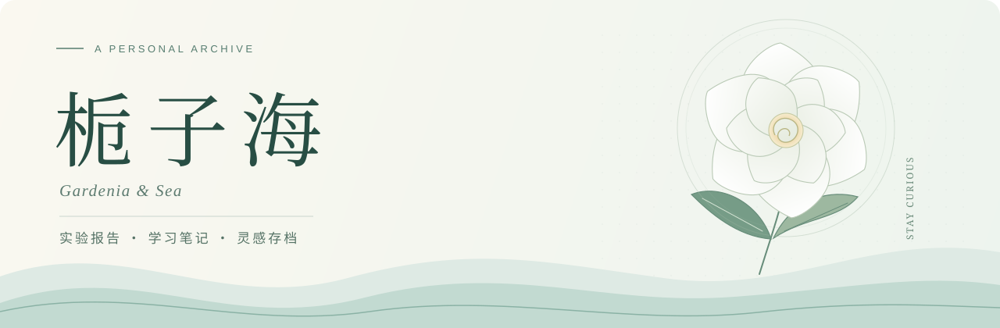

  

EXPERIMENTS &amp; EVERYDAY DISCOVERIES

<h2 align="center">在探索中记录，在记录中生长。</h2>

  你好，这里是 <b>栀子海</b>。
   
  收集实验报告、学习笔记，以及值得留下的片刻灵感。

 

<table>
  <tr>
    <td width="50%" valign="top">
      01 / LAB JOURNAL
      <h3>实验报告</h3>
      
从一个问题开始，让观察、数据与结论都有迹可循。

      <a href="https://github.com/2426157663-collab/2426157663-collab/tree/main/reports">翻阅实验记录 →</a>
    </td>
    <td width="50%" valign="top">
      02 / FIELD NOTES
      <h3>学习与随记</h3>
      
整理知识的脉络，也留住偶然闪现的想法。

      <a href="https://github.com/2426157663-collab/2426157663-collab/tree/main/notes">走进笔记角落 →</a>
    </td>
  </tr>
</table>

 

<i>让好奇有回声，让思考有着落。</i>

栀子海 &nbsp; · &nbsp; A quiet place for curious minds.

